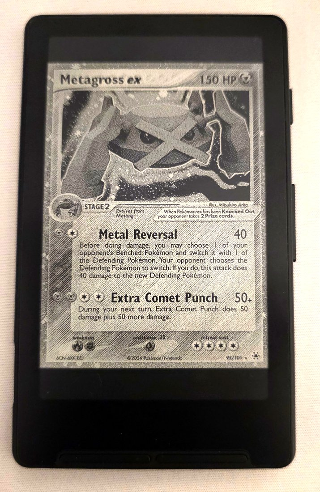
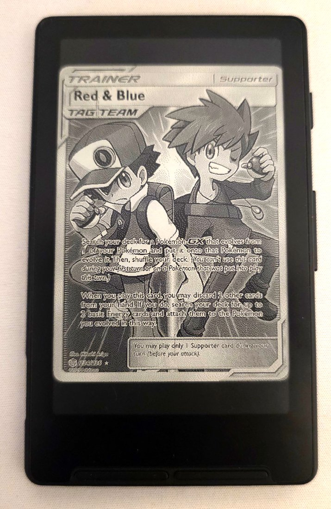

# trmnl-cards

Turn an Xteink X4 into a tiny frame for rare cards.

<p align="center">
  
  &nbsp;&nbsp;
  
</p>

Every 5 minutes your reader shows a different high value card. Cards come from every era, from Base Set holos to modern Special Illustration Rares.

## How it works

The reader runs [TRMNL](https://trmnl.com)'s open-source firmware, which turns it into a dashboard: it wakes up, downloads a picture from a server, shows it and goes back to sleep. Instead of TRMNL's own server, you point it at this one, which hands out a different card every 5 minutes.

## Set up your reader

You'll need a computer with Chrome or Edge and a USB-C cable.

1. Go to [trmnl.com/flash](https://trmnl.com/flash), choose your model (e.g. **X4**), plug the reader in and install the firmware.
2. When it restarts, the reader creates a Wi-Fi network called **TRMNL**. Join it from your phone; a setup page should open.
3. Open **Advanced**, and set **Custom Server** to:

   ```
   https://trmnl-cards.mdnahian.workers.dev
   ```

   No slash at the end.
4. Pick your home Wi-Fi (it has to be 2.4 GHz), enter the password and save.

The first card should appear within a minute. No account or sign-up needed.

**Already set up with TRMNL?** Hold the power button for about 5 seconds to get back to the Wi-Fi setup page, then follow steps 2–4. Don't hold it for 15 seconds or more, as that wipes the device's settings.

## Compatibility

| Device | Status |
| --- | --- |
| Xteink X4 | Works. This is what the photos above show. |
| Xteink X3 | Should work. TRMNL has an X3 build and cards are made for its 792×528 screen, but it hasn't been tested. |
| Xteink X4 Pro | Unknown. TRMNL doesn't have a separate build for it. |
| Other TRMNL devices | Will connect, but get the X4-sized image. On screens that stand landscape, cards will look sideways. |

A few things to know before flashing:

- The TRMNL firmware **replaces the e-reader software** (stock or CrossPoint). To read books again, flash it back.
- Cards are shown in black and white. The X4 didn't display 4-shade grayscale in testing.
- The reader connects to Wi-Fi every 5 minutes, so expect to charge it every few days instead of every few weeks.

## About the cards

- Prices are TCGplayer market prices for **raw (ungraded)** cards, refreshed once a week. Graded slabs aren't counted.
- A card counts at its most valuable printing, so a card with a $1,300 1st Edition counts as $1,300 even if the unlimited copy is cheaper.
- Card data and scans come from [TCGdex](https://tcgdex.dev). The rotation goes through every card once before repeating, which takes about 5 days.

## Running your own

All of this is in the repo if you'd rather host it yourself or change the settings (price cutoff, darkness, background).

- `server.py` runs everything on your own computer: `python3 server.py`, then point the reader at `http://<your-computer's-ip>:2300`. Needs Python 3 and Pillow.
- The hosted version is a Cloudflare Worker (`worker/`) plus `build.py`, which a daily GitHub Action runs to fetch prices and upload new cards. Nothing image-related is stored in the repo.
- Settings are environment variables, listed at the top of `cards.py`, `server.py` and `build.py`.

---

Not affiliated with Nintendo, The Pokémon Company, Xteink or TRMNL. Pokémon card images © Nintendo, Creatures and GAME FREAK.
